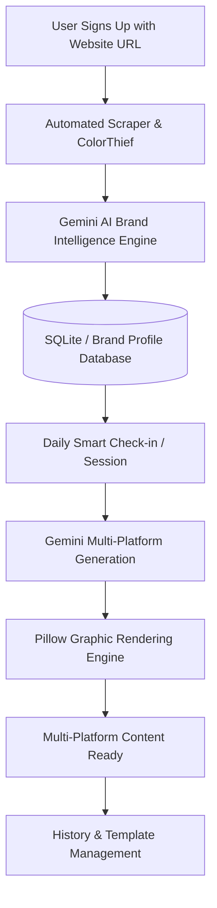
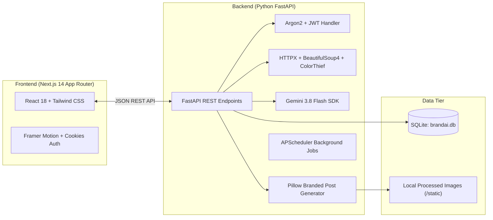
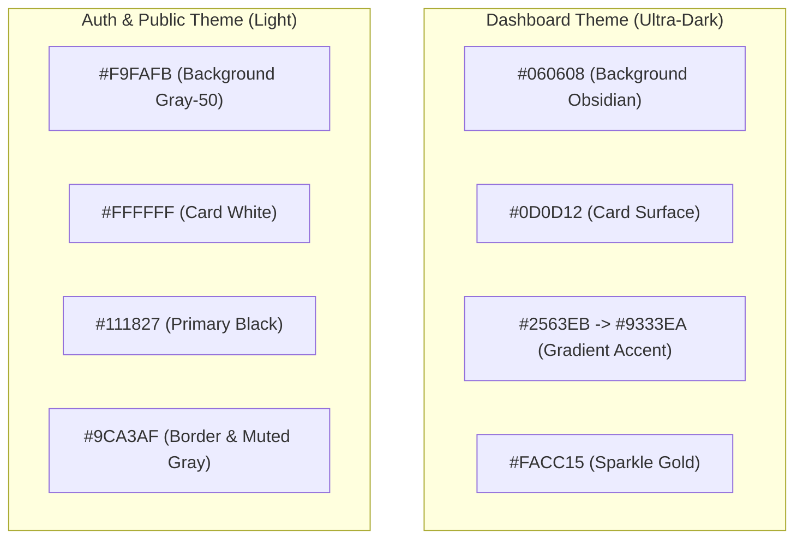
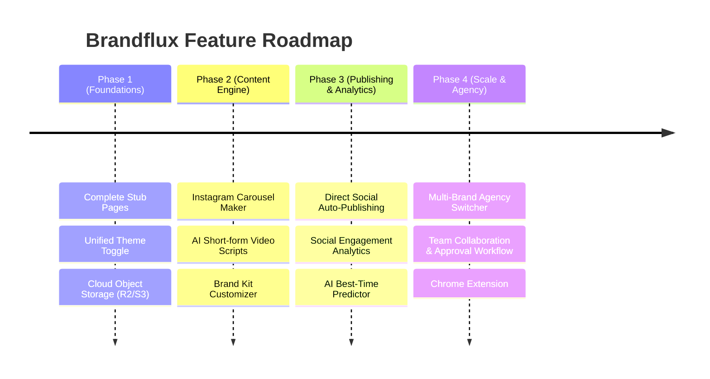

# Brandflux: Comprehensive Application & Architectural Report

---

## Executive Summary

**Brandflux** is an AI-powered brand intelligence and content generation platform engineered for small businesses, founders, creators, and digital agencies. The platform automates social media marketing by extracting a brand's unique identity (voice, visual style, colors, and products) directly from their website and translating daily business updates into platform-optimized posts, hashtags, and branded graphical assets.

---

## 1. System Architecture & How Brandflux Works

Brandflux operates as a decoupled full-stack application consisting of a Next.js 14 frontend and a FastAPI backend with background scheduling and AI integration.

### High-Level Architecture Diagram

### Core Workflows

1. **Intelligent Onboarding & Brand Extraction**:
   - The user registers with their email, password, and website URL.
   - The backend runs an asynchronous background task (`BrandScraper`) that fetches the target webpage, extracts metadata, headlines, logo images, and detects the primary color palette via `colorthief`.
   - The raw data is evaluated by Gemini AI to establish business type, industry, brand tone, target audience, keywords, and content pillars.
2. **Daily Check-In ("Smart Sessions")**:
   - Brandflux presents the user with 3 adaptive daily questions (or quick-select tags like *"Special Discount"*, *"New Product"*, *"Behind the Scenes"*).
   - This prevents generic AI copy by infusing fresh, real-time business context into every post.
3. **Multi-Platform Copy & Strategy Generation**:
   - Gemini transforms the brand identity and daily answers into distinct platform-tailored copy:
     - **Instagram Posts**: Visual hooks, emoji spacing, 20–30 optimized hashtags, CTAs.
     - **Instagram Stories**: Punchy vertical copy, interactive prompts.
     - **LinkedIn**: Thought-leadership framing, professional tone, business takeaways.
     - **Facebook**: Community-driven, conversational updates.
4. **Automated Visual Graphic Creation**:
   - The backend's `image_generator.py` uses Pillow (PIL) to generate 1:1 and 9:16 post assets.
   - It composites background gradients/textures, embeds the brand's extracted primary color, and draws responsive, wrapped typography with call-to-action badges.
5. **Background Automation & Proactive Guidance**:
   - An active APScheduler worker runs daily jobs at 6:00 AM to generate daily smart questions and weekly marketing guidance.

---

## 2. Page-by-Page & UI Breakdown

| Route | Status | Design & Purpose |
|---|---|---|
| `/` (Landing Page) | Complete | High-conversion marketing page featuring hero copy, dynamic interactive pricing tier toggles (Starter, Growth, Pro), feature cards, and social proof. |
| `/login` & `/signup` | Complete | Clean, centered card forms. Features auto-detection of business type on website input blur, remember-me cookies, and field validation. |
| `/dashboard` | Complete | Overview command center. Displays brand identity snapshot, website rescan trigger, daily session status banner, monthly usage metrics, and recent post history. |
| `/session` | Complete | Core 3-phase interactive wizard:  1. *Input form* (daily questions/tags) 2. *Animated generation screen* with progress steps 3. *Results tabview* with multi-platform copy, copy-to-clipboard buttons, graphic previews, and one-click image downloads. |
| `/ideas` | Complete | Content archive featuring two sub-views: *Daily Session History* and *Saved Templates* with quick-copy capabilities. |
| `/calendar` | **Stub** | Placeholder (8 lines of code). Needs a full scheduling grid. |
| `/settings` | **Stub** | Placeholder (8 lines of code). Needs account and brand kit editing. |
| `/pricing` | **Stub** | Placeholder (8 lines of code). Needs billing plans and checkout. |

---

## 3. UI/UX & Color System Analysis

### Current Color Palette

### Identified UI/UX Inconsistencies & Weaknesses

1. **Theme Disconnect (Light vs. Dark Polar Opposites)**:
   - The public landing page and auth pages (`/login`, `/signup`) are styled with pure white cards and light gray backgrounds (`#F9FAFB`).
   - Once a user signs in, they are immediately transitioned to an ultra-dark obsidian dashboard (`#060608`).
   - *Recommendation*: Introduce a unified design system. Either implement a cohesive dark aesthetic across all pages or offer a smooth system-aware theme toggle (`next-themes`) across the entire app.
2. **Typography Hierarchy**:
   - Currently relies on system default `Arial, Helvetica, sans-serif` in `globals.css` with Geist Mono loaded for select elements.
   - *Recommendation*: Standardize on **Inter**, **Plus Jakarta Sans**, or **Geist** across all components for a premium SaaS feel.
3. **Empty States & Loading Polish**:
   - While skeletons exist for some lists, several state transitions could benefit from micro-animations, consistent button loading states, and sticky navigation headers.

---

## 4. Key Areas Requiring Immediate Improvement

### A. Completing the Stub Pages
- **Calendar Page (`/calendar`)**: Replace the stub with an interactive monthly/weekly calendar view (e.g. using `FullCalendar` or `@tanstack/react-table`) displaying scheduled and past posts with status badges (*Draft*, *Scheduled*, *Published*).
- **Settings Page (`/settings`)**: Implement a comprehensive Brand Kit editor allowing users to modify their extracted brand colors, upload alternate logos, edit brand voice keywords, and update account credentials.
- **Pricing & Subscription Page (`/pricing`)**: Build a live billing portal integrating Stripe Checkout / Customer Portal to manage tiers (*Free*, *Growth*, *Pro*).

### B. Database & Production Readiness
- **SQLite to PostgreSQL Migration**: SQLite (`brandai.db`) is ideal for local development, but concurrent writes and multiple server workers in production require **PostgreSQL** (e.g., Supabase, Neon, or AWS RDS).
- **Alembic Database Migrations**: Currently, tables are created via `models.Base.metadata.create_all()`. Introducing Alembic will allow schema versioning without data loss.
- **Static Assets Storage**: Generated post images are stored in a local directory (`backend/processed_images`). For scalable deployments (Docker, AWS, Vercel/Fly.io), transition to an S3-compatible cloud bucket (AWS S3, Cloudflare R2, or Supabase Storage).

### C. Security & API Hardening
- **CORS Configuration**: Restrict allowed origins in production rather than allowing all headers/methods.
- **API Rate Limiting**: Protect AI generation endpoints (`/content/generate`, `/sessions/generate-all`) with `slowapi` or Redis token buckets to prevent quota depletion.

---

## 5. Strategic Roadmap: Features to Add

### 1. Direct Social Media Auto-Publishing
- **Current State**: Users copy captions and download images to post manually.
- **Future Feature**: Integrate official APIs (Meta Graph API for Instagram/Facebook, LinkedIn Marketing API, Pinterest API, X/Twitter API) to allow **1-click scheduled auto-publishing**.

### 2. Multi-Slide Carousel Generator
- Carousels receive up to 3x higher engagement on Instagram and LinkedIn.
- Add an automated 3-to-7 slide carousel designer that breaks down educational topics into sequential slides with consistent branding.

### 3. Multi-Brand / Agency Workspace Switcher
- Enable marketing agencies and social media managers to manage multiple client brand profiles under a single user account with a top-bar brand switcher.

### 4. AI Performance & Feedback Loop
- Ingest real post performance metrics (likes, shares, comments) to continuously fine-tune the Gemini prompts, prioritizing topics and styles that resonate most with each brand's audience.

---

## Summary Matrix

| Category | Current State | Target Future State |
|---|---|---|
| **Database** | SQLite file (`brandai.db`) | Managed PostgreSQL + Alembic migrations |
| **Image Storage** | Local folder (`/processed_images`) | Cloudflare R2 / AWS S3 with CDN delivery |
| **Theme** | Mixed (Light Auth / Dark Dashboard) | Cohesive design with light/dark toggle |
| **Publishing** | Manual Copy & Image Download | Automated 1-click publishing via Social APIs |
| **Planning** | Inactive Stub | Interactive drag-and-drop Content Calendar |
| **AI Model** | Gemini 3.8 Flash + 2.5 Flash Fallback | Gemini 3.8 Flash with custom fine-tuning & RAG |
| **Account Tier** | Static free/growth flags | Real-time Stripe subscription billing & webhooks |
